<p align="center">
  
</p>

<p align="center">
  <a href="https://github.com/ishandutta2007/Awesome-Awesome-Awesome"></a>
  <a href="https://discord.gg/jc4xtF58Ve"></a>
  <a href="LICENSE"></a>
  <a href="#-how-to-contribute"></a>
  <a href="https://github.com/ishandutta2007/Awesome-Project-Work-Management/stargazers"></a>
  <a href="https://github.com/ishandutta2007"></a>
</p>

---

# 🚀 Awesome Project & Work Management

> **A curated index of premier SaaS Work Operating Systems (Work OS) and sovereign open-source project management platforms.**  
> *Targeted at Engineering Leads, Technical Project Managers, Operations Directors, and Sovereign Infrastructure Engineers.*

Welcome to the definitive ecosystem directory for **Project & Work Management Software**. Modern organizations depend on collaborative work management platforms to orchestrate agile sprint cadences, align company-wide OKRs, track multi-project portfolios, visualize Gantt dependencies, and manage team capacity.

Whether you need a high-scale enterprise cloud suite like **Workday**, **Monday.com**, and **Asana**, or wish to eliminate per-seat licensing lock-in by self-hosting sovereign open-source alternatives like **Plane**, **OpenProject**, **AFFiNE**, and **AppFlowy**, this guide provides structured evaluations, verified pricing tiers, free plan thresholds, market analysis, and GitHub star metrics.

---

## 📑 Table of Contents

- [🌐 Sector Overview & Market Dynamics](#-sector-overview--market-dynamics)
- [🏢 Enterprise SaaS & Hosted Platforms](#-enterprise-saas--hosted-platforms)
- [🔓 Top Open-Source GitHub Projects](#-top-open-source-github-projects)
- [🛠️ Feature Comparison: SaaS vs Open-Source](#️-feature-comparison-saas-vs-open-source)
- [🤝 How to Contribute](#-how-to-contribute)
- [⚖️ Disclaimer & Governance](#️-disclaimer--governance)
- [📈 Star History](#-star-history)
- [💖 Support & Sponsoring](#-support--sponsoring)

---

## 🌐 Sector Overview & Market Dynamics

- **Market Size & Expansion**: The global **Project & Work Management Software** market is valued between **$8.7 Billion and $11.3 Billion in 2025–2026** and is projected to surge at a Compound Annual Growth Rate (CAGR) of **11.0% to 15.4%**, eclipsing **$23.0 Billion to $32.0 Billion by the early 2030s**. Growth is catalyzed by distributed remote teams, hybrid work coordination, predictive resource analytics, and generative AI agents that automate backlog triaging and workflow routing.
- **Market Dynamics & Fragmentation**: The sector is **moderately to highly fragmented** rather than a winner-take-all monopoly. While public titans and venture-backed category creators (Workday, Atlassian, Monday.com, Asana, Smartsheet) capture the lion's share of Fortune 500 enterprise spend, extreme workflow divergence—from unstructured relational workspaces (Notion, Airtable) to structured software delivery lifecycles (Jira, Linear) and data-sovereign on-premise installations (Plane, OpenProject, NocoDB)—fosters durable demand for specialized niche tools and self-hosted open-source software.

---

## 🏢 Enterprise SaaS & Hosted Platforms

The table below catalogs premier SaaS work operating systems, ordered in **descending order by company size** (market capitalization or latest enterprise valuation).

| 🏢 Platform | 🏛️ Company Size (Valuation / Revenue) | 💵 Starting Tier Pricing | 🎁 Free Tier / Trial Limits | ⚡ Key Highlights & Ideal Use Case |
| :--- | :--- | :--- | :--- | :--- |
| **[Workday Project & Work Management](https://www.workday.com/)** | **~$70.0B Market Cap** (NASDAQ: WDAY)<br>• Annual Revenue: ~$7.3B | **~$35.00 – $100.00 / user / month**<br>*(Enterprise PSA/HCM bundle; annual agreements typically start at $50,000/yr)* | **30-day guided enterprise sandbox / trial**<br>*(Pre-configured demo tenant with full resource capacity, milestone billing & financials)* | Enterprise ERP-native work management; links talent pools, skill matrices, project budgets, and revenue recognition seamlessly. |
| **[Atlassian (Trello & Jira)](https://www.atlassian.com/)** | **~$48.0B Market Cap** (NASDAQ: TEAM)<br>• Annual Revenue: ~$4.4B | **$5.00 / user / month** *(Trello Standard, billed annually; $6.00 billed monthly)*<br>• Jira: **$7.75 / user / month** | **Free forever up to 10 users per workspace**<br>*(Unlimited cards, up to 10 boards per workspace, unlimited Power-Ups, 10MB file attachments; Jira includes 2GB storage)* | The global benchmark for Kanban visual task boards (Trello) and Agile Scrum sprint workflows (Jira); massive integration ecosystem. |
| **[Monday.com](https://monday.com/)** | **~$13.5B Market Cap** (NASDAQ: MNDY)<br>• Annual Revenue: ~$950M | **$9.00 / seat / month** *(Basic tier, billed annually, min 3 seats = $27/mo; $12.00 billed monthly)* | **Free forever up to 2 seats**<br>*(Up to 3 boards, 200+ templates, 8 column types, 500MB storage; includes 14-day Pro trial)* | Highly visual Work OS with custom status boards, automated cross-board notifications, timeline views, and low onboarding friction. |
| **[Airtable](https://www.airtable.com/)** | **~$11.7B Valuation** (Series F)<br>• Estimated ARR: ~$250M+ | **$20.00 / seat / month** *(Team tier, billed annually; $24.00 billed monthly)* | **Free forever up to 5 editors / creators**<br>*(Unlimited bases, 1,000 records per base, 1GB attachment limit per base, 100 automation runs/month)* | Relational database meets interactive spreadsheet; empowers ops teams to build tailored workflow applications, dashboards, and automated forms. |
| **[Notion](https://www.notion.com/)** | **~$10.0B Valuation**<br>• Estimated ARR: ~$300M+ | **$10.00 / user / month** *(Plus tier, billed annually; $12.00 billed monthly)* | **Free forever for individual users**<br>*(Unlimited pages & blocks, up to 10 guest collaborators, 5MB file upload cap, trial blocks for teams)* | Connected block-based workspace combining company wikis, project trackers, docs, and databases with AI summarization and writing aids. |
| **[Smartsheet](https://www.smartsheet.com/)** | **~$8.4B Valuation** (Acquired by Blackstone / Vista)<br>• Annual Revenue: ~$1.1B | **$9.00 / user / month** *(Pro tier, billed annually, max 10 users; $12.00 billed monthly)* | **30-day unrestricted free trial**<br>*(Unlimited sheets, Gantt timelines, automated workflows, dashboards & forms; unlimited free viewers post-trial)* | Dynamic spreadsheet work execution platform featuring critical path computation, all 4 dependency relationships, and baseline audits. |
| **[ClickUp](https://clickup.com/)** | **~$4.0B Valuation** (Series C)<br>• Estimated ARR: ~$150M+ | **$7.00 / user / month** *(Unlimited tier, billed annually; $10.00 billed monthly)* | **Free forever with unlimited members**<br>*(100MB cloud storage, unlimited tasks, two-factor auth, collaborative docs, 60 uses of custom fields)* | All-in-one productivity suite with 15+ interactive views (List, Board, Gantt, Mind Maps), whiteboard canvas, native docs, and sprint goals. |
| **[Asana](https://asana.com/)** | **~$3.2B Market Cap** (NYSE: ASAN)<br>• Annual Revenue: ~$650M | **$10.99 / user / month** *(Starter tier, billed annually; $13.49 billed monthly)* | **Free forever up to 10 teammates**<br>*(Unlimited tasks, projects, messages, activity logs, 100MB attachment limit, iOS/Android mobile apps)* | Goal-and-task hierarchy platform with automated rule triggers, Gantt timelines, team workload balancing, and multi-team portfolio tracking. |
| **[Wrike](https://www.wrike.com/)** | **~$2.25B Valuation** (STG / Citrix Spinout)<br>• Estimated ARR: ~$200M+ | **$9.80 / user / month** *(Team tier, billed annually, 2–25 users)* | **Free forever for unlimited users**<br>*(2GB storage, web/mobile apps, Kanban board view, subtask management, cloud storage sync; 14-day enterprise trial)* | Enterprise work management built for marketing, creative, and professional services; features cross-project Gantt, proofing, and request forms. |
| **[Basecamp](https://basecamp.com/)** | **~$750M Est. Valuation** (37signals)<br>• Estimated ARR: ~$50M+ | **$15.00 / user / month** *(Pay-as-you-go, billed monthly)*<br>• Pro Unlimited: **$299.00 / month flat** | **30-day full-featured free trial**<br>*(Full platform access, unlimited projects, unlimited users, 500GB storage, no credit card required)* | Opinionated, calm project management suite integrating to-do lists, message boards, automatic team check-ins, campfire chat, and shared docs. |

---

## 🔓 Top Open-Source GitHub Projects

Below are the most prominent open-source project management and collaborative work platforms on GitHub, **sorted in descending order by Stars_Count**. Each entry includes an official live social Stars_Badge linking directly to the project's stargazers.

### 1. [AppFlowy](https://github.com/AppFlowy-IO/AppFlowy) [](https://github.com/AppFlowy-IO/AppFlowy/stargazers)
- **Primary Stack**: Flutter, Rust, SQLite
- **License**: AGPL-3.0
- **Overview**: The leading open-source Notion alternative. AppFlowy brings projects, wikis, and team knowledge bases together with native offline support, end-to-end data encryption, and local-first data storage without vendor lock-in.

### 2. [AFFiNE](https://github.com/toeverything/AFFiNE) [](https://github.com/toeverything/AFFiNE/stargazers)
- **Primary Stack**: TypeScript, Rust, React, Node.js
- **License**: MIT
- **Overview**: Next-generation open-source workspace merging docs, whiteboards, and database tables into an infinite canvas. Seamlessly transitions between structured document writing and freeform visual brainstorming.

### 3. [NocoDB](https://github.com/nocodb/nocodb) [](https://github.com/nocodb/nocodb/stargazers)
- **Primary Stack**: TypeScript, Vue.js, Node.js, SQL (PostgreSQL, MySQL, SQLite)
- **License**: AGPL-3.0
- **Overview**: The open-source smart spreadsheet and Airtable alternative. Connects directly to any relational database to transform raw tables into collaborative grids, Kanban boards, galleries, and calendar views with REST APIs.

### 4. [Plane](https://github.com/makeplane/plane) [](https://github.com/makeplane/plane/stargazers)
- **Primary Stack**: Python (Django), TypeScript, Next.js, PostgreSQL, Redis, MinIO
- **License**: AGPL-3.0
- **Overview**: Modern, extensible open-source project management software positioned as a sovereign Jira, Linear, and ClickUp alternative. Features work issues, Cycles (sprint cadences), Modules, Pages (docs), and 5 layout views.

### 5. [Trilium Notes](https://github.com/TriliumNext/Notes) [](https://github.com/TriliumNext/Notes/stargazers)
- **Primary Stack**: JavaScript, Node.js, SQLite, CodeMirror
- **License**: AGPL-3.0
- **Overview**: Hierarchical personal knowledge base and structured task management system designed for building large, deeply nested knowledge trees, personal workflows, and encrypted project notes.

### 6. [Huly Platform](https://github.com/hcengineering/platform) [](https://github.com/hcengineering/platform/stargazers)
- **Primary Stack**: TypeScript, React, Node.js, Elastic, MongoDB
- **License**: AGPL-3.0
- **Overview**: An all-in-one open-source project management and collaborative workspace alternative to Linear, Jira, Slack, and Notion. Offers ultra-fast issue tracking, virtual office communication, and project roadmaps.

### 7. [Focalboard](https://github.com/mattermost-community/focalboard) [](https://github.com/mattermost-community/focalboard/stargazers)
- **Primary Stack**: Go, TypeScript, React, PostgreSQL/SQLite
- **License**: AGPL-3.0 / Apache-2.0
- **Overview**: Open-source, multilingual, self-hosted alternative to Trello, Notion, and Asana developed by the Mattermost community. Provides card-based task boards, table views, and custom schema attributes for dev teams.

### 8. [Super Productivity](https://github.com/super-productivity/super-productivity) [](https://github.com/super-productivity/super-productivity/stargazers)
- **Primary Stack**: TypeScript, Angular, Electron
- **License**: MIT
- **Overview**: Advanced open-source to-do list, time-tracker, and sprint planner tailored for software engineers. Ships with bidirectional integrations for GitHub Issues, GitLab, Jira, and OpenProject.

### 9. [Docmost](https://github.com/docmost/docmost) [](https://github.com/docmost/docmost/stargazers)
- **Primary Stack**: TypeScript, NestJS, React, PostgreSQL, Redis
- **License**: AGPL-3.0
- **Overview**: Open-source collaborative wiki and technical documentation management software. Serves as a modern self-hosted alternative to Confluence and Notion with real-time multi-user editing.

### 10. [Wekan](https://github.com/wekan/wekan) [](https://github.com/wekan/wekan/stargazers)
- **Primary Stack**: Meteor, JavaScript, MongoDB
- **License**: MIT
- **Overview**: Fully featured FLOSS Kanban board platform with zero telemetry. Delivers real-time card collaboration, swimlanes, subtasks, user permissions, and one-click import from Trello and CSV files.

### 11. [OpenProject](https://github.com/opf/openproject) [](https://github.com/opf/openproject/stargazers)
- **Primary Stack**: Ruby on Rails, Angular, PostgreSQL
- **License**: GPL-3.0
- **Overview**: Enterprise-grade open-source project management suite. Supports classical waterfall Gantt planning, Agile Scrum/Kanban boards, multi-project portfolio visibility, time logging, and cost reporting.

### 12. [Habitica](https://github.com/HabitRPG/habitica) [](https://github.com/HabitRPG/habitica/stargazers)
- **Primary Stack**: JavaScript, Vue.js, Node.js, Express, MongoDB
- **License**: GPL-3.0
- **Overview**: Gamified task management and habit tracker that treats real-world projects and everyday goals like a Role Playing Game (RPG) complete with rewards, boss battles, quests, and party collaborations.

### 13. [Planka](https://github.com/plankanban/planka) [](https://github.com/plankanban/planka/stargazers)
- **Primary Stack**: JavaScript, React, Redux, Node.js, PostgreSQL
- **License**: AGPL-3.0
- **Overview**: Elegant, responsive open-source Kanban tracking tool designed for small teams and enterprises. Supports project boards, member assignments, card attachments, Markdown cards, and notifications.

### 14. [Leantime](https://github.com/Leantime/leantime) [](https://github.com/Leantime/leantime/stargazers)
- **Primary Stack**: PHP, JavaScript, MySQL
- **License**: AGPL-3.0
- **Overview**: Strategic project management system designed for non-project managers, built with neurodivergence (ADHD, autism, dyslexia) in mind. Combines design thinking, lean canvas, and Agile sprint roadmaps.

### 15. [Invoice Ninja](https://github.com/invoiceninja/invoiceninja) [](https://github.com/invoiceninja/invoiceninja/stargazers)
- **Primary Stack**: PHP (Laravel), Flutter, MySQL
- **License**: AGPL-3.0
- **Overview**: Source-available business execution, invoicing, project tracking, and time management application. Bridges task management with customer invoicing, expense logging, and payment gateways.

### 16. [Kanboard](https://github.com/kanboard/kanboard) [](https://github.com/kanboard/kanboard/stargazers)
- **Primary Stack**: PHP, SQLite / PostgreSQL / MySQL
- **License**: MIT
- **Overview**: Minimalist visual task board focusing strictly on simplicity and speed. Features swimlanes, Work-in-Progress (WIP) limits, task automation rules, and zero complex runtime dependencies.

### 17. [Kaneo](https://github.com/usekaneo/kaneo) [](https://github.com/usekaneo/kaneo/stargazers)
- **Primary Stack**: TypeScript, Node.js, Docker
- **License**: AGPL-3.0
- **Overview**: Pragmatic project management that prevents the management tool from becoming the project itself. Features streamlined boards, Gantt charts, issue roadmaps, and seamless GitHub integration.

### 18. [Ever Gauzy](https://github.com/ever-co/ever-gauzy) [](https://github.com/ever-co/ever-gauzy/stargazers)
- **Primary Stack**: TypeScript, NestJS, Angular, TypeORM, PostgreSQL
- **License**: AGPL-3.0
- **Overview**: Open enterprise management platform uniting Project Management, CRM, HRM, and Time Tracking. Designed for remote teams, consultancies, and digital agencies requiring integrated resource accounting.

### 19. [Redmine](https://github.com/redmine/redmine) [](https://github.com/redmine/redmine/stargazers)
- **Primary Stack**: Ruby on Rails, MySQL / PostgreSQL
- **License**: GPL-2.0
- **Overview**: The battle-tested, classic open-source project management and issue tracking system. Offers cross-project Gantt schedules, calendar overviews, wikis, forums, and granular role-based access control (RBAC).

### 20. [Vikunja](https://github.com/go-vikunja/vikunja) [](https://github.com/go-vikunja/vikunja/stargazers)
- **Primary Stack**: Go, TypeScript, Vue.js, SQLite / PostgreSQL / MySQL
- **License**: AGPL-3.0
- **Overview**: The to-do and project manager you actually own. Features flexible task lists, Kanban columns, Gantt timelines, Table views, repeating tasks, subtask hierarchies, and quick Docker deployment.

### 21. [Kan](https://github.com/kanbn/kan) [](https://github.com/kanbn/kan/stargazers)
- **Primary Stack**: TypeScript, Node.js, PostgreSQL, Docker
- **License**: MIT
- **Overview**: Lightweight Trello-inspired Kanban application featuring workspace visibility controls, custom labels, card comments, activity audit logs, and direct Trello board import capabilities.

### 22. [Taiga](https://github.com/taigaio/taiga-back) [](https://github.com/taigaio/taiga-back/stargazers)
- **Primary Stack**: Python (Django), AngularJS / Next, PostgreSQL
- **License**: MPL-2.0
- **Overview**: Acclaimed open-source Agile project management platform for software designers and cross-functional teams. Specializes in Scrum sprints with burndown metrics and customizable Kanban workflows.

### 23. [LibrePlan](https://github.com/LibrePlan/libreplan) [](https://github.com/LibrePlan/libreplan/stargazers)
- **Primary Stack**: Java, ZK Framework, PostgreSQL
- **License**: AGPL-3.0
- **Overview**: Open-source web-based enterprise planning application built for resource allocation, capacity management, Gantt scheduling, and cross-project portfolio governance in sovereign cloud environments.

---

## 🛠️ Feature Comparison: SaaS vs Open-Source

| Capability / Dimension | 🏢 Enterprise SaaS (Asana, Monday, Workday) | 🔓 Sovereign Open-Source (Plane, OpenProject, AppFlowy) |
| :--- | :--- | :--- |
| **Data Sovereignty & Privacy** | Multi-tenant cloud or dedicated enterprise VPC; subject to vendor data residency policies. | **100% self-hosted** on bare metal, AWS/GCP, or private data centers; complete ownership of databases. |
| **Licensing & Seat Costs** | Per-user recurring subscriptions ($5 to $35+/user/mo); costs scale linearly with team headcount. | **Zero per-seat licensing fees**; community editions run without user caps; optional paid enterprise support. |
| **Customizability & Extensibility** | Configurable via marketplace plugins, webhooks, and REST APIs; core UX governed by vendor. | **Full source code access** (AGPL, GPL, MIT); forkable, extensible database schemas, custom plugins. |
| **Maintenance Burden** | Zero infrastructure overhead; automatic upgrades, security patches, and high-availability SLAs. | Requires DevOps effort for Docker/Kubernetes cluster orchestration, database backups, and version upgrades. |
| **Compliance & Auditing** | SOC2 Type II, ISO 27001, HIPAA, and GDPR certifications managed and guaranteed by provider. | Organizations must configure their own security hardenings, reverse proxies, and backup retention policies. |

---

## 🤝 How to Contribute

Contributions are warmly encouraged! To propose a new SaaS platform, add an open-source tool, or correct pricing data:

1. **Fork the Repository**: Click the `Fork` button at the top right of this repository.
2. **Create a Feature Branch**:
   ```bash
   git checkout -b feature/add-new-work-tool
   ```
3. **Update `README.md`**:
   - For SaaS tools: Insert into the SaaS table in descending valuation order with verified pricing, company size, and specific free trial terms.
   - For Open-Source tools: Append into the open-source list sorted in descending star order, including the official live Stars_Badge link `[](https://github.com/owner/repo/stargazers)`.
4. **Adhere to Code of Conduct**: Maintain factual, vendor-neutral descriptions without promotional hyperbole.
5. **Submit a Pull Request**: Provide a clear explanation and links to official documentation or source repos.

---

## ⚖️ Disclaimer & Governance

- This compilation is **curated by the open-source community** for informational and educational purposes. Inclusion does not imply official endorsement or commercial sponsorship.
- SaaS subscription fees, feature limits, and free tier allowances reflect public data as of **October 2026** and are subject to change by respective vendors.
- When evaluating open-source software for commercial environments, verify license compatibility (**AGPL-3.0, GPL-3.0, MIT, MPL-2.0**) with your legal counsel.

---

## 📈 Star History

[](https://star-history.dera.page/#ishandutta2007/Awesome-Project-Work-Management&type=date&legend=top-left)

---

## 💖 Support & Sponsoring

A massive thank you to everyone exploring, contributing to, and bookmarking this ecosystem directory! If you find this curated collection of project & work management platforms helpful for your team, startup, or enterprise infrastructure, please consider supporting the project:

- ⭐ **Star this repository** on GitHub to amplify its reach and community visibility.
- 🍴 **Fork and contribute** your favorite tools, architecture notes, and self-hosted guides.
- 📢 **Share with your network**, engineering leads, project managers, and DevOps teams.
- ☕ **Buy me a coffee & sponsor ongoing maintenance** via the [GitHub Sponsor Dashboard](https://github.com/sponsors/ishandutta2007).

Your sponsorship directly funds research, real-time verification of open-source projects, and keeping this knowledge base evergreen!
